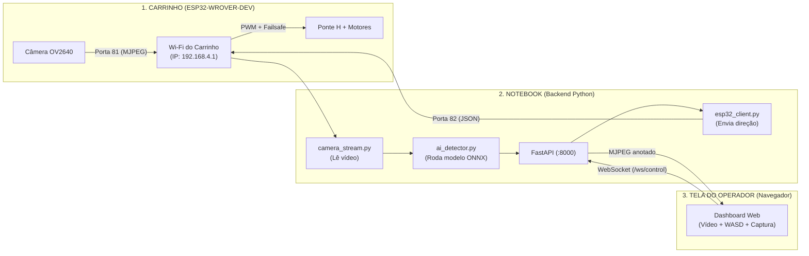

# Plano de Implementação e Guia do Grupo — Rover de Inspeção de Pavimento

Este documento explica **como o sistema funciona** de forma simples e divide o projeto em **frentes paralelas e etapas** para todo o grupo trabalhar ao mesmo tempo sem conflitos.

---

## 1. A Arquitetura Explicada de Forma Simples

O projeto é dividido em **3 partes**, cada uma com um papel bem definido:

1. **O Carrinho (`firmware/` — ESP32-WROVER-DEV + OV2640 + Motores):** é o **corpo e os olhos**.
   - Ele **não** roda inteligência artificial pesada dentro do chip (isso deixaria o vídeo travando a 1–2 FPS).
   - Ele faz apenas duas coisas rápidas:
     1. Filma o chão com a câmera OV2640 e envia o vídeo pelo Wi-Fi.
     2. Escuta comandos numéricos de velocidade das rodas e aciona a Ponte H.
2. **O Notebook (`backend/` — Python + FastAPI + OpenCV + ONNX):** é o **cérebro**.
   - Recebe o vídeo da câmera pela rede Wi-Fi.
   - Passa cada imagem pelo modelo de IA para detectar **buracos** e **rachaduras**.
   - Recebe os comandos do operador e envia para o carrinho.
3. **O Navegador (`frontend/` — HTML/CSS/JS):** é o **controle remoto + monitor**.
   - Exibe o vídeo já anotado pela IA, mostra se o carrinho está conectado e envia os comandos de teclado (`W/A/S/D`), botões na tela ou controle gamepad.

### Os dois fluxos acontecendo ao mesmo tempo
- **Fluxo de Vídeo (Câmera → IA → Tela):** a ESP32 serve fotos contínuas em `http://192.168.4.1:81/stream`. O Python sempre pega apenas o frame mais recente (para não acumular atraso), roda a IA e entrega o vídeo anotado em `/video_feed`.
- **Fluxo de Controle (Teclado → Carrinho):** o navegador calcula a força das rodas (`left` e `right` de `-255` a `+255`) e manda via WebSocket (`/ws/control`). O Python repassa para a porta `82` da ESP32.
- **Segurança (Failsafe):** se o carrinho ficar mais de **500 ms** sem receber comando (ex.: perda de Wi-Fi), a ESP32 desliga os motores automaticamente.

---

## 2. Combinados Técnicos (Contratos Entre os Módulos)

Para que o código de cada membro se encaixe sem dor de cabeça no final:

| Integração | Combinado / Formato |
| :--- | :--- |
| **Vídeo (ESP32 → Python)** | Stream MJPEG em `http://<IP_ESP32>:81/stream` (padrão SoftAP: `http://192.168.4.1:81/stream`) |
| **Controle (Python → ESP32)** | WebSocket na porta `82` recebendo JSON `{"left": -255..255, "right": -255..255}` |
| **Modelo IA (`ai/` → Python)** | Arquivo `ai/models/pavement_yolov8n.onnx` com classes `0: rachadura`, `1: buraco`, `2: desnivel` |

---

## 3. Divisão de Tarefas por Frentes (Trabalho em Paralelo)

### Frente A — Hardware, Elétrica e Chassi
- [ ] Montar motores DC e Ponte H (`L298N`, `TB6612FNG` ou `DRV8833`) no chassi.
- [ ] **Separar a alimentação:** bateria exclusiva para os motores e fonte/regulador 5V separado para a ESP32, unindo **apenas o GND**. *(Evita que a ESP32 reinicie por queda de tensão quando os motores dão partida).*
- [ ] Conferir o pinout exato da placa **ESP32-WROVER-DEV + módulo DCX OV2640 v2** e atualizar `firmware/src/camera_pins.h` (nunca usar `GPIO 16/17` da PSRAM nem `GPIO 34–39` que são só entrada).
- [ ] Fixar a câmera inclinada para o chão (~30° a 45°) à frente do carrinho.

### Frente B — Firmware da ESP32 (`firmware/`)
- [ ] Abrir `firmware/` no PlatformIO (ou adaptar para Arduino IDE) e gravar o código inicial.
- [ ] Testar primeiro **só a câmera** (motores desligados): conectar na rede `RoverPavimento` e abrir `http://192.168.4.1:81/stream` no navegador.
- [ ] Ajustar resolução (`QVGA`/`VGA`), qualidade JPEG e espelhamento da imagem (`vflip`/`hmirror`) se necessário.
- [ ] Testar motores com o carrinho suspenso (rodas fora do chão) e validar se o *failsafe* de 500 ms para as rodas ao cortar o sinal.

### Frente C — Backend e Interface Web (`backend/` e `frontend/`)
- [ ] Testar o sistema em modo simulação (`ROVER_MOCK_MODE=true`) e entender as rotas em `backend/main.py`.
- [ ] Evoluir a interface (`frontend/`): adicionar suporte a controle Gamepad USB/Bluetooth, botão de gravação automática de frames (1 foto/s), histórico de detecções e exportação de relatório da vistoria.
- [ ] Integrar com o carrinho real criando `.env` a partir de `.env.example` (`ROVER_MOCK_MODE=false`).

### Frente D — Inteligência Artificial e Dataset (`ai/`)
- [ ] Preparar notebook de treinamento no Google Colab (YOLOv8n ou YOLO11n) e testar exportação `.onnx` (`imgsz=320`) com um dataset público inicial (ex.: *RDD2022* / *Pothole* no Roboflow).
- [ ] Quando o carrinho estiver rodando, coletar 200–500 imagens reais do pavimento da faculdade pelo botão **Capturar Frame** da interface (incluindo fotos sem falhas, com sombras e folhas, para reduzir falsos positivos).
- [ ] Rotular as imagens (Roboflow/CVAT), treinar o modelo final e salvar em `ai/models/pavement_yolov8n.onnx`.

---

## 4. Etapas do Projeto (Marcos do Grupo)

1. **Etapa 0 — Setup (Todos):** Configurar `.venv`, rodar o modo simulação e `pytest`.
2. **Etapa 1 — Entregas Isoladas:** Hardware andando na bancada (A), câmera + WebSocket rodando na ESP32 (B), painel melhorado no modo simulação (C), primeiro `.onnx` piloto testado no backend (D).
3. **Etapa 2 — Integração Hardware + Software:** Ligar `ROVER_MOCK_MODE=false`, conectar o notebook no Wi-Fi da ESP32 e pilotar o carrinho vendo o vídeo real pelo painel Web.
4. **Etapa 3 — Coleta no Campus e Treino Definitivo:** Dirigir o carrinho no pavimento da faculdade gravando o dataset real e treinar o modelo `.onnx` final.
5. **Etapa 4 — Validação e Banca:** Medir FPS, latência e acurácia em campo; preparar baterias extras e hotspot de backup para a apresentação.
